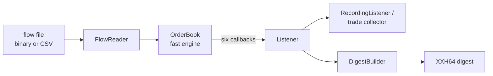
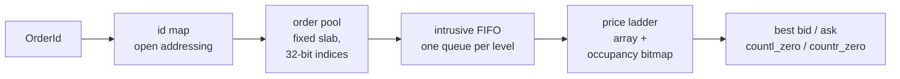
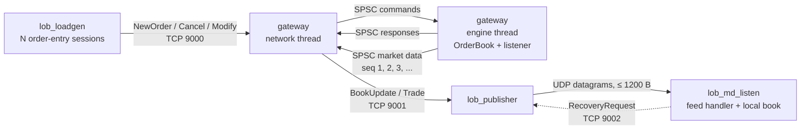

# matchbook-cpp

Price-time-priority matching engine in C++20 — zero hot-path allocations, differential-tested, nanosecond latency percentiles.

matchbook-cpp is a limit order book and matching engine in modern C++ built the way trading systems are: integer prices, no heap allocation on the hot path, every event deterministic. Correctness is proven by differential testing against a deliberately simple reference engine on millions of random orders, and performance is reported as honest latency percentiles with the machine and flags that produced them.

The author's background is mechatronics — memory layout, fixed-point arithmetic and deterministic timing on embedded systems — which is the same set of instincts low-latency C++ rewards.

`docs/architecture.md` fixes the event contract and the on-disk formats. The epic write-ups explain how each part was built and measured:

- [Epic 00 — foundation](docs/epic-00-foundation.md)
- [Epic 01 — engines, differential harness, tools and benchmarks](docs/epic-01-engines.md)
- [Epic 02 — the array price ladder](docs/epic-02-array-ladder.md)
- [Epic 03 — shipping v1.0.0](docs/epic-03-ship-v1.md)
- [Epic 04 — the lock-free SPSC ring](docs/epic-04-spsc-ring.md)
- [Epic 05 — Python bindings](docs/epic-05-python-bindings.md)
- [Epic 06 — fill-or-kill and post-only orders](docs/epic-06-fok-post-only.md)
- [Epic 07 — shipping v1.1.0](docs/epic-07-ship-v1-1.md)
- [Epic 08 — the wire protocol](docs/epic-08-wire-protocol.md)
- [Epic 09 — gateway, publisher and load generator](docs/epic-09-gateway-publisher-loadgen.md)
- [Epic 10 — the Compose demo](docs/epic-10-compose-demo.md)

## Benchmarks

Apple M5 (arm64, 32 GB), macOS 27.0.1, Apple clang 21.0.0 (clang-2100.3.34.2), `-O3 -DNDEBUG`, array price ladder, `batch128` latency mode, 10 repetitions per benchmark, 2026-10-28, commit `aed8e66`; 1-minute load average 1.55 before the run and 2.20 after it. Latency in nanoseconds, median run:

| Benchmark | p50 | p90 | p99 | p99.9 | max |
| --- | --- | --- | --- | --- | --- |
| Add order, non-crossing | 13 | 20 | 22 | 24 | 170 |
| Add order, crossing 1 level | 8 | 9 | 9 | 10 | 167 |
| Add order, crossing 2 levels | 14 | 15 | 16 | 19 | 167 |
| Add order, crossing 3 levels | 19 | 21 | 22 | 23 | 186 |
| Cancel, resting | 26 | 32 | 35 | 65 | 179 |
| Market order, sweep 1 level | 8 | 9 | 9 | 10 | 157 |
| Market order, sweep 2 levels | 14 | 15 | 16 | 18 | 173 |
| Market order, sweep 3 levels | 19 | 20 | 22 | 23 | 177 |
| Mixed flow | 32 | 41 | 46 | 80 | 346 |

Mixed flow throughput: **30,470,598 ops/s** (median run; 30,218,134–30,659,261 across the ten runs).

### Methodology

Apple M5 (arm64, 32 GB, macOS), Apple clang 21, release preset: `-O3 -DNDEBUG` with no `-march=native`, so the flags are reproducible on any Apple Silicon machine. The harness reads `cntvct_el0`, prints its rate and cross-checks it against the mach timebase. On this machine the counter declares 1 GHz but advances in steps of about 41.7 ns, so a single operation's timestamp is quantized to a couple of dozen values. Latency is therefore recorded in batches of N operations — the smallest power of two of at least 16 such that one sample spans 50 timer steps, labelled `batchN` — and divided by N; a machine whose counter steps by 2 ns or less uses true per-operation timestamps and is labelled `per_op`. Percentiles (p50, p90, p99, p99.9, max) come from an HDR histogram covering 1 ns to 10 ms at three significant figures. `scripts/run_benchmarks.sh --compare` runs five repetitions per round over two interleaved rounds per build (ten runs in total) and reports the median run; a single-build run is one round of five. macOS has no core isolation or thread pinning: the harness asks for user-interactive QoS and reports whether the hint was applied, but a busy machine still perturbs the tails. That is why `scripts/run_benchmarks.sh` refuses to start unless the 1-minute load average is at or below `LOB_BENCH_MAX_LOAD` (2.0 for the run above) and no compilers, builds or CI runner workers are running.

## The optimization

The initial price-level container was a `std::map<Price, Level>` per side: correct, but every level lookup walked a red-black tree, every best-price query started at `begin()`, and every new level took a node from a fixed pool. The current version replaces it with an array indexed by `price - min_price` over the configured range (at most 2^24 ticks, enforced at construction) plus a two-level occupancy bitmap: one bit per price, 64-bit summary words over the bitsets, so the best ask is `std::countr_zero` on the lowest occupied summary word and the best bid is `std::countl_zero` on the highest. A lookup is one indexed load, the next level is a few word scans with no pointer follows, and the whole structure is allocated once at construction.

Both ladders implement the same `PriceLadder` interface, so matching, the digest walk and the tests are unchanged. `release` (and `release-array`) build the array ladder; `release-tree` builds the tree baseline. Both presets pass the full test suite and the differential test, and the nightly runs the long differential test on both.

### Tree ladder vs array ladder

Same machine and flags as above; one `scripts/run_benchmarks.sh --compare` run interleaved the two builds over two rounds, ten runs per benchmark. Latency in nanoseconds, median run per build:

| Benchmark | p50 tree | p50 array | p50 ratio | p99 tree | p99 array | p99 ratio | p99.9 tree | p99.9 array | p99.9 ratio |
| --- | --- | --- | --- | --- | --- | --- | --- | --- | --- |
| Add order, non-crossing | 14 | 13 | 0.93× | 23 | 22 | 0.96× | 24 | 24 | 1.00× |
| Add order, crossing 1 level | 9 | 8 | 0.89× | 10 | 9 | 0.90× | 10 | 10 | 1.00× |
| Add order, crossing 2 levels | 15 | 14 | 0.93× | 17 | 16 | 0.94× | 21 | 19 | 0.90× |
| Add order, crossing 3 levels | 20 | 19 | 0.95× | 23 | 22 | 0.96× | 27 | 23 | 0.85× |
| Cancel, resting | 27 | 26 | 0.96× | 35 | 35 | 1.00× | 65 | 65 | 1.00× |
| Market order, sweep 1 level | 9 | 8 | 0.89× | 10 | 9 | 0.90× | 11 | 10 | 0.91× |
| Market order, sweep 2 levels | 15 | 14 | 0.93× | 17 | 16 | 0.94× | 20 | 18 | 0.90× |
| Market order, sweep 3 levels | 20 | 19 | 0.95× | 23 | 22 | 0.96× | 25 | 23 | 0.92× |
| Mixed flow | 33 | 32 | 0.97× | 47 | 46 | 0.98× | 84 | 80 | 0.95× |

Mixed flow throughput: 29,515,306 → 30,470,598 ops/s (1.03×).

The array ladder wins on the matching-heavy rows: crossing and market orders get 4–11% off p50 (0.89–0.95×), and the three-level sweep's p99.9 falls from 27 ns to 23 ns, because best-price and next-level lookups become indexed loads instead of tree descents. It helps least where the tree was never the cost: cancels are 0.96× at p50 and unchanged at p99, and non-crossing adds are flat at p99.9, so the overall gain is a few percent rather than an order of magnitude. Treat the tail columns as smoothed: these are `batch128` samples, each the per-op average over 128 operations, so the p99 and p99.9 figures understate the tail of a single operation.

## Order types

Five order types share one event contract (`docs/architecture.md` §4.1) and are implemented identically in the fast and the reference engine:

| Type | Semantics |
| --- | --- |
| Limit | Rests at its price in price-time priority and trades at the maker's resting price; a partial fill leaves the remainder resting. |
| Market | Ignores its price, takes whatever the opposite side offers and cancels the unfilled remainder; it never rests. |
| IOC | Matches like a limit order at its price, then cancels what is left instead of resting it. |
| FOK | Fills completely and immediately at its limit, or not at all: a kill cancels the full submitted quantity and leaves the book untouched. It never rests. |
| PostOnly | Adds liquidity only: rejected with `WouldCross` when the opposite side already crosses its limit, otherwise it rests like a limit order. |

A fill always happens at the resting order's price, and a partially filled maker keeps its place in the queue. `modify` keeps priority only when the price is unchanged and the quantity shrinks; any other modify is cancel + new, so the order goes to the back of its level. Rejections follow a fixed order in both engines — quantity, price, duplicate id — and a capacity limit that prevents a remainder from resting cancels that remainder rather than rejecting the order.

`lobsim gen` can emit every type and the differential test can compare them:

```sh
./build/release/lobsim gen --orders 200000 --seed 42 --types all --out build/release/flow-all.bin
./build/release/lobsim replay build/release/flow-all.bin --engine fast --digest
./build/release/lobsim difftest --ops 200000 --seed 42 --types all
```

The default `--types basic` keeps FOK and post-only out of the mix, so CI never compares an engine that implements them with one that does not; `--types all` adds them at about 5 % each, including post-only orders priced through the book so the `WouldCross` path is exercised. The nightly job runs both mixes on both ladders.

## Correctness

- **Event contract.** `docs/architecture.md` §4 fixes the six callbacks and their exact order for every operation: accept, reject, trade at the resting price, cancel, in-place reduce, book update. Both engines are written against that text, and a listener must not call back into the book.
- **Reference engine.** `lob::ref::ReferenceBook` is a deliberately naive `std::map` + `std::list` implementation with an `std::unordered_map` id index. It shares only the frozen `types.hpp`, `config.hpp`, `listener.hpp` and `digest.hpp` headers with the fast engine and is never optimized.
- **Differential test.** `lobsim difftest` runs a seeded operation stream through both engines with recording listeners; after every operation the event vectors and the XXH64 book digests must be identical. The suite runs 1,000,000 random operations plus five stress configurations: tight order capacity (200,000 operations), tight level capacity (200,000), a three-price range (200,000), a wide 1–200,000-tick config at 300,000 operations (books hundreds of levels deep), and a ladder-stress mix (200,000) that clusters prices on the occupancy bitmap boundaries, sweeps a side empty and drains and refills the best level. Operation counts scale down under sanitizers. `./build/release/lobsim difftest --ops 1000000 --seed 42` ends with `mismatches: 0`, and the nightly runs five fresh seeds per ladder at 2,000,000 operations (narrow) and 200,000 (wide).
- **Fresh-clone audits.** Each epic close is re-checked from a fresh clone of `main` outside the test suite: bootstrap vcpkg, build every preset, run the full suite, and repeat the differential runs by hand. The audits ran 10,000,000-operation `lobsim difftest` streams on both ladders, on fixed seed 7 and on a fresh seed, plus a wide-config run (200,000 operations, 665 levels deep) and the 2,000,000-operation ladder-stress mix; every run ended with `mismatches: 0`. Reproduce any of them with `./build/release/lobsim difftest --ops 10000000 --seed 7`, adding `--config wide` or `--mix ladder_stress`. The nightly workflow (`.github/workflows/nightly.yml`) keeps a rolling version: five seeds per run, both the `release` and `release-tree` presets, 2,000,000 narrow and 200,000 wide operations each.
- **Allocation test.** `test_alloc` replaces every global `operator new`/`delete` form and counts allocations only around the measured loop. A positive control allocates through all eight `operator new` forms while armed and requires all eight to be counted; the hot-path test then performs 1,000,000 operations after warm-up and requires zero. It skips under ASan/TSan, where the sanitizer interceptors make exact counts unreliable.
- **Determinism.** `scripts/check_determinism.sh` generates one flow, replays it in the debug and release builds with both engines and requires the digests to agree within and across builds.
- **Tardis-derived flow.** `tests/data/tardis_sample.csv.gz` is the first hour of Binance ETHBTC `incremental_book_L2` for 2026-10-01 (18,774 rows), converted to a flow file with exact integer decimal parsing. The conversion builds synthetic per-level queues from L2 deltas and cancels crossed levels before they can trade, so replay is trade-free; the reference engine's final digest is pinned as `0xea3b4198b591dd6d`.

## Concurrency

The gateway runs the book on one thread and every socket on another. The handoff between them is `lob::SpscRing<T, Capacity>` (`include/lob/spsc_ring.hpp`), a bounded lock-free single-producer/single-consumer ring:

- Capacity is a compile-time power of two, so the slot index is a mask, and the storage is an inline byte buffer decided at construction. `try_push` and `try_pop` report full or empty instead of waiting, never allocate, never throw and never enter the kernel.
- The two indices live on separate cache lines (128 bytes, the measured M-series line and its prefetched pair), and each side caches the other side's index, so the common full/empty decision reads only thread-private memory.
- Ordering uses acquire and release only: the producer publishes a slot with a release store of the tail, the consumer takes it with an acquire load and frees the slot with a release store of the head. There is no sequential consistency and no fence.

`tests/test_spsc_ring.cpp` pins the API, the FIFO order, the exact-full boundary, the wrap behaviour and the cache-line layout, and runs a two-thread order-and-content check. The `tsan` preset runs the whole suite under ThreadSanitizer as a required CI check. Two tools exercise the ring at volume:

```sh
./build/release/spsc_stress --messages 100000000
./build/release/spsc_latency --messages 1000000
cmake --preset tsan && cmake --build --preset tsan && ctest --preset tsan
```

`spsc_stress` moves 100 million messages through a 4,096-entry ring and checks strict sequence order and a payload bijection on every one. `spsc_latency` measures the enqueue-to-`on_accept` handoff through a deliberately small (256-entry) ring and prints p50/p90/p99/p99.9/max with the same timer-mode policy as the benchmark harness. Ring latency is published only from an idle-machine run:

<!-- RING-LATENCY -->

Numbers pending an idle-machine run.

## Design



A flow file is read record by record and driven into the `OrderBook`. The book emits the event contract through the abstract `Listener`; the test harness records every event for comparison, while the digest builder walks the resting book in price-time order and hashes its canonical byte stream with XXH64.



The fast engine allocates its pool, id map and ladder once, when the book is constructed. An order id hashes to a pool index; the pool node sits in its price level's intrusive FIFO; the ladder owns the levels and answers best-price queries from the bitmap. Adds, cancels, modifies and matches therefore touch only pre-allocated memory.

## Python

`python/pylob` binds the same C++ engine with pybind11; no matching logic is reimplemented in Python. The repository root is a uv workspace whose only member is `pylob`, so one command builds and installs it:

```sh
uv sync --frozen
uv run python -c "import pylob; print(pylob.OrderBook)"
```

The binding exposes `Config`, `OrderBook`, the `Side`, `OrderType` and `RejectReason` enums, a recording listener, a flow reader and a two-engine replay, with the same event order and digest as the C++ API. A Python listener is a Python call per event with the GIL held, which is convenient for experiments and not a latency measurement tool.

Replay a flow and plot the bid/ask spread:

```sh
./build/release/lobsim gen --orders 20000 --seed 7 --out build/release/spread.bin
uv run python examples/replay_spread.py --flow build/release/spread.bin --out build/release/spread.png
```

The example replays the flow record by record through `pylob.OrderBook`, samples the best bid and ask every 100 records and writes a PNG with matplotlib, which the repository environment installs through the `plot` group.

## Exchange simulator

Phase 3 splits the stack into processes that speak the wire protocol of `docs/architecture.md` §14 over TCP, plus one UDP hop for market data (decision C54):



Three long-running processes plus the load generator as a client:

| Process | Executable | Ports | Threads |
| --- | --- | --- | --- |
| Gateway | `lob_gateway` | order entry TCP 9000, market-data stream TCP 9001 | one network thread, one engine thread |
| Publisher | `lob_publisher` | connects to 9001, UDP fan-out to every `--udp-dest`, recovery TCP 9002 | one poll loop |
| Feed handler | `lob_md_listen` | UDP receive 9100, connects to recovery 9002 | one thread |
| Load generator | `lob_loadgen` | connects to 9000, optional UDP monitor and recovery | one send loop, one monitor thread when it counts market data |

One connection is one session. The engine order id is `(session_id << 40) | client_order_id`, responses carry the client's own order id back, and the engine publishes every book update and trade on the event stream with a gap-free sequence number that starts at 1. The publisher keeps the last 65,536 messages by default (up to 1,048,576) and answers a recovery request with the frames it still holds, or with a `SequenceReset` when they have aged out. The feed handler buffers out-of-order frames while a gap is open, asks for the missing range and applies the recovered frames in sequence. When the stream has had no event for 100 ms the gateway emits a `Heartbeat` carrying the last published sequence; the publisher forwards it like any other message, and the feed handler treats a heartbeat above its last seen sequence as a gap, so a lost final datagram is still detected and recovered.

The Compose demo from the Phase 3 definition of done builds one Linux image and runs the whole topology on a private bridge network:

```sh
docker compose up -d --build
docker compose run --rm loadgen --orders 1000000 --report /out/w2w.json
docker compose down
```

`scripts/compose_demo.sh` runs those three commands and prints the load generator's report. The same topology runs natively on loopback, with free ports picked by the script, two sessions and 50,000 orders; it fails unless the report shows zero unanswered orders and zero unrecovered market-data gaps:

```sh
scripts/e2e_local.sh build/release/apps/gateway/lob_gateway \
  build/release/apps/publisher/lob_publisher \
  build/release/apps/md_listen/lob_md_listen \
  build/release/apps/loadgen/lob_loadgen 50000
```

`lob_loadgen` sends orders in a closed loop, times each send to its first response with an HDR histogram and writes a JSON report with the latency percentiles, unanswered-order count and market-data gap counters. Wire-to-wire latency that includes both processes and the kernel loopback path is published only from `scripts/run_phase23_benchmarks.sh` on an idle machine; Docker figures are never published as latency results:

<!-- W2W-LATENCY -->

Numbers pending an idle-machine run.

## Build and run

Prerequisites on macOS:

```sh
xcode-select --install
brew install cmake ninja pkg-config uv
```

`cmake` and `ninja` drive the build, `pkg-config` is required by vcpkg's pkg-config fix-up for the `hdr-histogram` port, and `uv` runs the report scripts. The C++ dependencies themselves come from vcpkg, not Homebrew.

Clone, build and run the test suite:

```sh
git clone https://github.com/broiisapro/matchbook-cpp.git
cd matchbook-cpp
./scripts/bootstrap_vcpkg.sh
cmake --preset release
cmake --build --preset release
ctest --preset release
```

`scripts/bootstrap_vcpkg.sh` clones the pinned vcpkg release into `./vcpkg`. Set `VCPKG_ROOT` to reuse an existing clone, for example `export VCPKG_ROOT="$HOME/.cache/matchbook/vcpkg"`.

Generate a seeded flow and replay it on both engines:

```sh
./build/release/lobsim gen --orders 1000000 --seed 42 --out build/release/flow.bin
./build/release/lobsim replay build/release/flow.bin --engine fast --digest
./build/release/lobsim replay build/release/flow.bin --engine reference --digest
```

Differential-test the engines:

```sh
./build/release/lobsim difftest --ops 1000000 --seed 42
```

Run the benchmark suites and render a report:

```sh
./build/release/lob_bench --benchmark_filter='AddOrder|Cancel|Market|MixedFlow' \
  --benchmark_repetitions=5 \
  --benchmark_out=build/release/bench.json --benchmark_out_format=json
uv run scripts/bench_report.py build/release/bench.json > build/release/bench.md
```

Convert the committed Tardis sample and replay it:

```sh
./build/release/lobsim convert-tardis tests/data/tardis_sample.csv.gz --out build/release/tardis.bin
./build/release/lobsim replay build/release/tardis.bin --engine reference --digest
```

Publishable latency and throughput numbers come from `scripts/run_benchmarks.sh`, which builds the release preset, runs `lob_bench --self-test`, takes five repetitions and renders the Markdown report. It refuses to run on a busy machine.

## Demo


## Limitations

- Single instrument. There is no symbol routing or multi-book support, and the engine itself is single-threaded: the gateway gives it one dedicated thread and keeps every socket on another.
- No logon or authentication. One accepted connection is one session and there is no session-resume message, so a client that reconnects starts a new session with a new id.
- Resting orders survive a client disconnect. There is no mass cancel and no cancel-on-disconnect in v2.0, so a crashed client leaves its orders in the book.
- Market data is unicast UDP by default: the publisher fans out to its `--udp-dest` list and multicast is an opt-in extra destination that nothing joins. There are no snapshots, so a late subscriber starts at the current sequence and builds its book from later updates.
- No self-trade prevention.
- No persistence and no stop orders.
- The Tardis flow is synthetic: it reconstructs per-level queues from L2 deltas, so it has no order-level queue position and is not real order flow. It is used for determinism and cross-engine checks, not for market-impact claims.
- Timing is macOS-specific. There is no core isolation or thread pinning, and the ~41.7 ns counter step means sub-step operations are only measurable in batches. Reported numbers belong to the machine and flags that produced them.
- Docker is a correctness and demo environment, not a latency environment: numbers measured inside a container are never published as results.
- The array price ladder covers at most 2^24 ticks per book.

## License

MIT. See [LICENSE](LICENSE).
