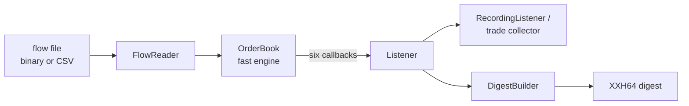
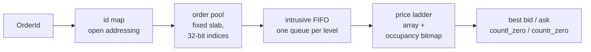
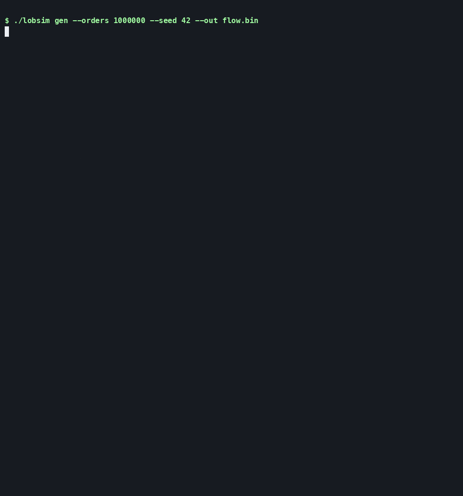

# matchbook-cpp

Price-time-priority matching engine in C++20 — zero hot-path allocations, differential-tested, nanosecond latency percentiles.

matchbook-cpp is a limit order book and matching engine in modern C++ built the way trading systems are: integer prices, no heap allocation on the hot path, every event deterministic. Correctness is proven by differential testing against a deliberately simple reference engine on millions of random orders, and performance is reported as honest latency percentiles with the machine and flags that produced them.

The author's background is mechatronics — memory layout, fixed-point arithmetic and deterministic timing on embedded systems — which is the same set of instincts low-latency C++ rewards.

## Benchmarks

Apple M5 (arm64, 32 GB), macOS 27.0.1, Apple clang 21.0.0 (clang-2100.3.34.2), `-O3 -DNDEBUG`, array price ladder, `batch128` latency mode, 10 repetitions per benchmark, 2026-10-28, commit `aed8e66`; 1-minute load average 1.55 before the run and 2.20 after it. Latency in nanoseconds, median run:

| Benchmark | p50 | p90 | p99 | p99.9 | max |
| --- | --- | --- | --- | --- | --- |
| Add order, non-crossing | 13 | 20 | 22 | 24 | 170 |
| Add order, crossing 1 level | 8 | 9 | 9 | 10 | 167 |
| Add order, crossing 2 levels | 14 | 15 | 16 | 19 | 167 |
| Add order, crossing 3 levels | 19 | 21 | 22 | 23 | 186 |
| Cancel, resting | 26 | 32 | 35 | 65 | 179 |
| Market order, sweep 1 level | 8 | 9 | 9 | 10 | 157 |
| Market order, sweep 2 levels | 14 | 15 | 16 | 18 | 173 |
| Market order, sweep 3 levels | 19 | 20 | 22 | 23 | 177 |
| Mixed flow | 32 | 41 | 46 | 80 | 346 |

Mixed flow throughput: **30,470,598 ops/s** (median run; 30,218,134–30,659,261 across the ten runs).

### Methodology

Apple M5 (arm64, 32 GB, macOS), Apple clang 21, release preset: `-O3 -DNDEBUG` with no `-march=native`, so the flags are reproducible on any Apple Silicon machine. The harness reads `cntvct_el0`, prints its rate and cross-checks it against the mach timebase. On this machine the counter declares 1 GHz but advances in steps of about 41.7 ns, so a single operation's timestamp is quantized to a couple of dozen values. Latency is therefore recorded in batches of N operations — the smallest power of two of at least 16 such that one sample spans 50 timer steps, labelled `batchN` — and divided by N; a machine whose counter steps by 2 ns or less uses true per-operation timestamps and is labelled `per_op`. Percentiles (p50, p90, p99, p99.9, max) come from an HDR histogram covering 1 ns to 10 ms at three significant figures. `scripts/run_benchmarks.sh --compare` runs five repetitions per round over two interleaved rounds per build (ten runs in total) and reports the median run; a single-build run is one round of five. macOS has no core isolation or thread pinning: the harness asks for user-interactive QoS and reports whether the hint was applied, but a busy machine still perturbs the tails. That is why `scripts/run_benchmarks.sh` refuses to start unless the 1-minute load average is at or below `LOB_BENCH_MAX_LOAD` (2.0 for the run above) and no compilers, builds or CI runner workers are running.

## The optimization

The initial price-level container was a `std::map<Price, Level>` per side: correct, but every level lookup walked a red-black tree, every best-price query started at `begin()`, and every new level took a node from a fixed pool. The current version replaces it with an array indexed by `price - min_price` over the configured range (at most 2^24 ticks, enforced at construction) plus a two-level occupancy bitmap: one bit per price, 64-bit summary words over the bitsets, so the best ask is `std::countr_zero` on the lowest occupied summary word and the best bid is `std::countl_zero` on the highest. A lookup is one indexed load, the next level is a few word scans with no pointer follows, and the whole structure is allocated once at construction.

Both ladders implement the same `PriceLadder` interface, so matching, the digest walk and the tests are unchanged. `release` (and `release-array`) build the array ladder; `release-tree` builds the tree baseline. Both presets pass the full test suite and the differential test, and the nightly runs the long differential test on both.

### Tree ladder vs array ladder

Same machine and flags as above; one `scripts/run_benchmarks.sh --compare` run interleaved the two builds over two rounds, ten runs per benchmark. Latency in nanoseconds, median run per build:

| Benchmark | p50 tree | p50 array | p50 ratio | p99 tree | p99 array | p99 ratio | p99.9 tree | p99.9 array | p99.9 ratio |
| --- | --- | --- | --- | --- | --- | --- | --- | --- | --- |
| Add order, non-crossing | 14 | 13 | 0.93× | 23 | 22 | 0.96× | 24 | 24 | 1.00× |
| Add order, crossing 1 level | 9 | 8 | 0.89× | 10 | 9 | 0.90× | 10 | 10 | 1.00× |
| Add order, crossing 2 levels | 15 | 14 | 0.93× | 17 | 16 | 0.94× | 21 | 19 | 0.90× |
| Add order, crossing 3 levels | 20 | 19 | 0.95× | 23 | 22 | 0.96× | 27 | 23 | 0.85× |
| Cancel, resting | 27 | 26 | 0.96× | 35 | 35 | 1.00× | 65 | 65 | 1.00× |
| Market order, sweep 1 level | 9 | 8 | 0.89× | 10 | 9 | 0.90× | 11 | 10 | 0.91× |
| Market order, sweep 2 levels | 15 | 14 | 0.93× | 17 | 16 | 0.94× | 20 | 18 | 0.90× |
| Market order, sweep 3 levels | 20 | 19 | 0.95× | 23 | 22 | 0.96× | 25 | 23 | 0.92× |
| Mixed flow | 33 | 32 | 0.97× | 47 | 46 | 0.98× | 84 | 80 | 0.95× |

Mixed flow throughput: 29,515,306 → 30,470,598 ops/s (1.03×).

The array ladder wins on the matching-heavy rows: crossing and market orders get 4–11% off p50 (0.89–0.95×), and the three-level sweep's p99.9 falls from 27 ns to 23 ns, because best-price and next-level lookups become indexed loads instead of tree descents. It helps least where the tree was never the cost: cancels are 0.96× at p50 and unchanged at p99, and non-crossing adds are flat at p99.9, so the overall gain is a few percent rather than an order of magnitude. Treat the tail columns as smoothed: these are `batch128` samples, each the per-op average over 128 operations, so the p99 and p99.9 figures understate the tail of a single operation.

## Correctness

- **Event contract.** `docs/architecture.md` §4 fixes the six callbacks and their exact order for every operation: accept, reject, trade at the resting price, cancel, in-place reduce, book update. Both engines are written against that text, and a listener must not call back into the book.
- **Reference engine.** `lob::ref::ReferenceBook` is a deliberately naive `std::map` + `std::list` implementation with an `std::unordered_map` id index. It shares only the frozen `types.hpp`, `config.hpp`, `listener.hpp` and `digest.hpp` headers with the fast engine and is never optimized.
- **Differential test.** `lobsim difftest` runs a seeded operation stream through both engines with recording listeners; after every operation the event vectors and the XXH64 book digests must be identical. The suite runs 1,000,000 random operations plus five stress configurations: tight order capacity (200,000 operations), tight level capacity (200,000), a three-price range (200,000), a wide 1–200,000-tick config at 300,000 operations (books hundreds of levels deep), and a ladder-stress mix (200,000) that clusters prices on the occupancy bitmap boundaries, sweeps a side empty and drains and refills the best level. Operation counts scale down under sanitizers. `./build/release/lobsim difftest --ops 1000000 --seed 42` ends with `mismatches: 0`, and the nightly runs five fresh seeds per ladder at 2,000,000 operations (narrow) and 200,000 (wide).
- **Allocation test.** `test_alloc` replaces every global `operator new`/`delete` form and counts allocations only around the measured loop. A positive control allocates through all eight `operator new` forms while armed and requires all eight to be counted; the hot-path test then performs 1,000,000 operations after warm-up and requires zero. It skips under ASan/TSan, where the sanitizer interceptors make exact counts unreliable.
- **Determinism.** `scripts/check_determinism.sh` generates one flow, replays it in the debug and release builds with both engines and requires the digests to agree within and across builds.
- **Tardis-derived flow.** `tests/data/tardis_sample.csv.gz` is the first hour of Binance ETHBTC `incremental_book_L2` for 2026-10-01 (18,774 rows), converted to a flow file with exact integer decimal parsing. The conversion builds synthetic per-level queues from L2 deltas and cancels crossed levels before they can trade, so replay is trade-free; the reference engine's final digest is pinned as `0xea3b4198b591dd6d`.

## Design



A flow file is read record by record and driven into the `OrderBook`. The book emits the event contract through the abstract `Listener`; the test harness records every event for comparison, while the digest builder walks the resting book in price-time order and hashes its canonical byte stream with XXH64.



The fast engine allocates its pool, id map and ladder once, when the book is constructed. An order id hashes to a pool index; the pool node sits in its price level's intrusive FIFO; the ladder owns the levels and answers best-price queries from the bitmap. Adds, cancels, modifies and matches therefore touch only pre-allocated memory.

## Build and run

Prerequisites on macOS:

```sh
xcode-select --install
brew install cmake ninja pkg-config uv
```

Clone, build and run the test suite:

```sh
git clone https://github.com/broiisapro/matchbook-cpp.git
cd matchbook-cpp
./scripts/bootstrap_vcpkg.sh
cmake --preset release
cmake --build --preset release
ctest --preset release
```

`scripts/bootstrap_vcpkg.sh` clones the pinned vcpkg release into `./vcpkg`. Set `VCPKG_ROOT` to reuse an existing clone, for example `export VCPKG_ROOT="$HOME/.cache/matchbook/vcpkg"`.

Generate a seeded flow and replay it on both engines:

```sh
./build/release/lobsim gen --orders 1000000 --seed 42 --out build/release/flow.bin
./build/release/lobsim replay build/release/flow.bin --engine fast --digest
./build/release/lobsim replay build/release/flow.bin --engine reference --digest
```

Differential-test the engines:

```sh
./build/release/lobsim difftest --ops 1000000 --seed 42
```

Run the benchmark suites and render a report:

```sh
./build/release/lob_bench --benchmark_filter='AddOrder|Cancel|Market|MixedFlow' \
  --benchmark_repetitions=5 \
  --benchmark_out=build/release/bench.json --benchmark_out_format=json
uv run scripts/bench_report.py build/release/bench.json > build/release/bench.md
```

Convert the committed Tardis sample and replay it:

```sh
./build/release/lobsim convert-tardis tests/data/tardis_sample.csv.gz --out build/release/tardis.bin
./build/release/lobsim replay build/release/tardis.bin --engine reference --digest
```

Publishable latency and throughput numbers come from `scripts/run_benchmarks.sh`, which builds the release preset, runs `lob_bench --self-test`, takes five repetitions and renders the Markdown report. It refuses to run on a busy machine.

## Demo



## Limitations

- Single instrument, single thread. There is no concurrency, symbol routing or multi-book support.
- The Tardis flow is synthetic: it reconstructs per-level queues from L2 deltas, so it has no order-level queue position and is not real order flow. It is used for determinism and cross-engine checks, not for market-impact claims.
- Timing is macOS-specific. There is no core isolation or thread pinning, and the ~41.7 ns counter step means sub-step operations are only measurable in batches. Reported numbers belong to the machine and flags that produced them.
- No self-trade prevention.
- Phase 2 features are not included: FOK, post-only and stop orders, persistence, networking and language bindings.
- The array price ladder covers at most 2^24 ticks per book.

## License

MIT. See [LICENSE](LICENSE).
